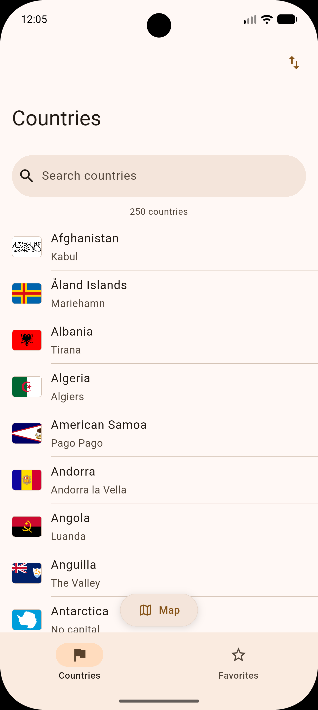
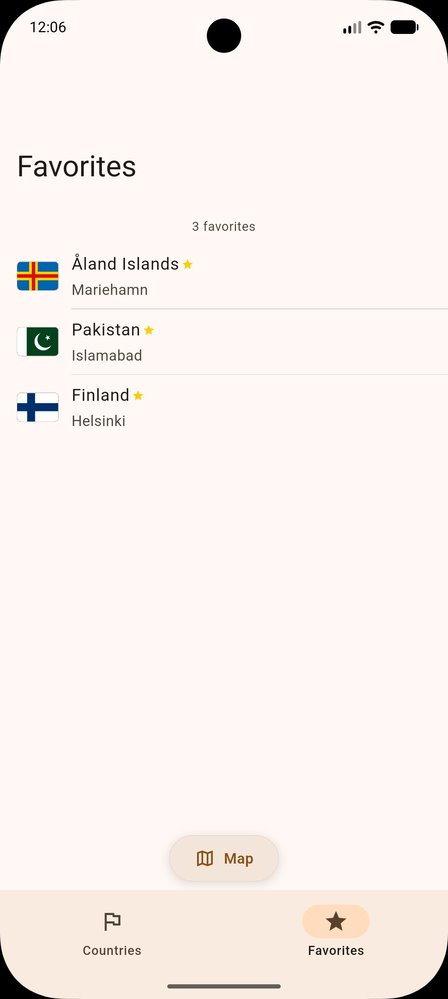
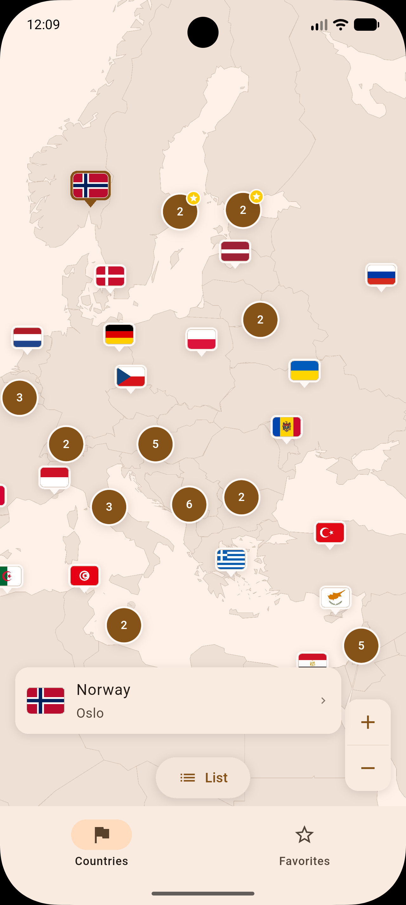
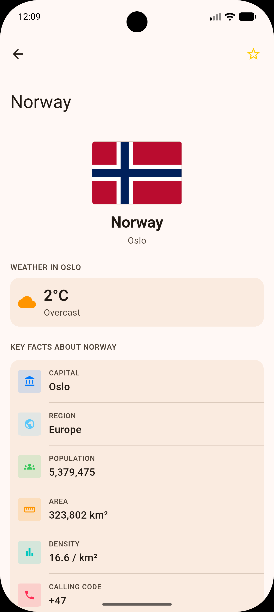
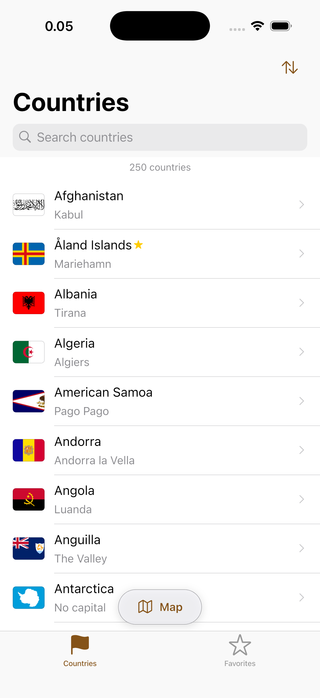
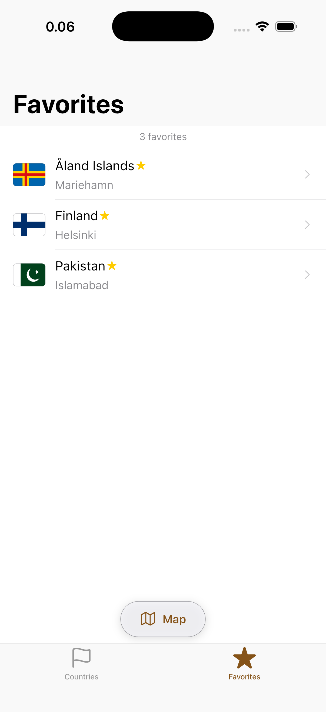
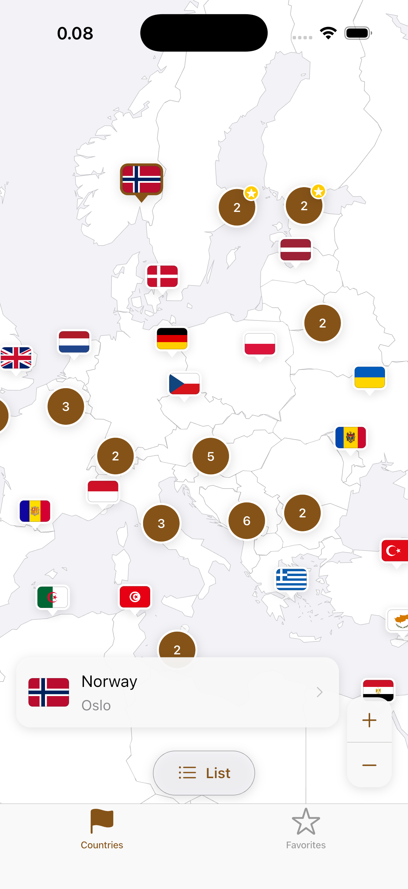
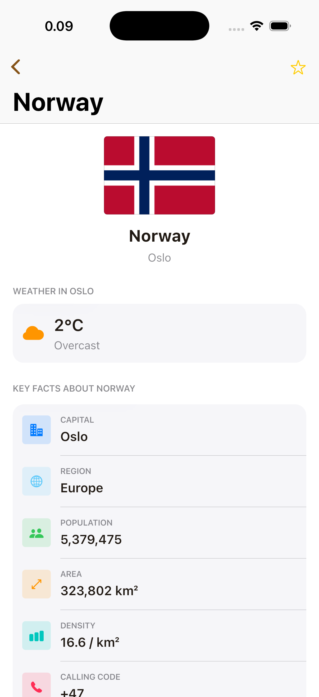

# CountryFinder

A Flutter app for iOS and Android to browse, search and save the world's
countries, with live weather for each capital and full offline support.

It shows how a production Flutter app is structured: one shared codebase that
still looks and feels native on each platform, and keeps working when the
network doesn't.

## Screenshots

### Android

<p>
  
  
  
  
</p>

### iOS

<p>
  
  
  
  
</p>

## Features

- **Browse 250 countries** with flags and capitals, sorted by name,
  population or area. The sort order is remembered.
- **Search right on the list:** a search bar under the title that scrolls
  away as you browse and stays put while you search. It ignores accents:
  "cote" finds Côte d'Ivoire and "turkiye" finds Türkiye, whatever the phone's
  language. A row under the search bar shows how many countries are listed,
  or "x of 250 countries" while searching.
- **Favorites**, saved on the device and listed newest first.
- **World map:** a Map/List button on Countries and Favorites switches the
  tab to a map of the same countries (search results, or just your
  favorites). The map is drawn by the app itself, with each country as a
  flag pin on its capital city. Nearby pins group into a counted circle until you zoom in, with
  pinch or the zoom buttons; tap a pin for the country's card, then its
  details. Favorites carry a star, on their pin or on the group they're in.
  Works offline.
- **Country details:** key facts, the neighbouring countries, and current
  weather in the capital.
- **Works offline:** the last downloaded data is kept on the device. A banner
  shows when you're looking at saved data, with a one-tap retry.
- **Native look on both platforms:** iOS gets iOS-style navigation and controls,
  Android gets Material 3, from the same code.
- **Light and dark mode**, and support for larger text sizes.

## Data: countries.dev

Country data comes from [countries.dev](https://countries.dev), a free, open
REST API for country information. For all 250 countries and territories it
provides ISO codes, flags, capitals, population, area, currencies, languages,
calling codes, time zones, coordinates and land borders. It needs no API key
and no sign-up.

How the app uses it:

- **One request loads everything:** `GET https://countries.dev/countries`
  returns every country at once, so browsing and search are instant.
- **Saved for offline use:** the response is stored on the device and used
  whenever the network is unavailable.
- **Robust to imperfect data:** missing fields are expected (about a third of
  countries have no `borders` field, for example), and a single malformed
  record is skipped rather than breaking the whole list.

Current weather comes from [Open-Meteo](https://open-meteo.com), also free and
keyless, using each country's coordinates. The map's country outlines and
capital cities come from [Natural Earth](https://www.naturalearthdata.com),
which is public domain, and are bundled with the app.

## Architecture

The app follows **MVVM (Model–View–ViewModel) with the Repository pattern**:

- **View:** screens and components. They only display state and pass on what
  the user does.
- **ViewModel:** Riverpod notifiers. Each holds a screen's state (loading,
  loaded or failed) and handles actions like refreshing or adding a favorite.
- **Model:** data classes, plus repositories that decide where data comes
  from: the network first, the on-device cache as a fallback.

Data flows in one direction. The UI shows the current state, user actions go
to a ViewModel, the ViewModel updates the state, and the UI follows. The UI
never talks to the network or the database directly:

```
Views                  screens & components; they only display state
        │
ViewModels (Riverpod)  screen state: loading, errors, favorites, sort order
        │
Repositories           where data comes from: network first, device cache as fallback
        │
API client · Database  HTTP requests and on-device storage
```

### Why this pattern

The app has two tabs over one dataset, each with a list and a map view, plus a detail screen. MVVM with
repositories gives clear boundaries and full testability without extra
ceremony:

- **Clean Architecture** would add a use-case layer between ViewModels and
  repositories. With logic this direct, most use cases would only pass calls
  through, adding files without adding clarity.
- **BLoC** would add an event class for every user action. Riverpod notifiers
  expose plain methods instead, which keeps the code shorter and just as
  testable.
- **It grows with the app.** If a feature brings heavier logic, such as route
  planning between countries, a use-case layer can be added for that feature
  alone without restructuring the rest.

A few principles run through the whole codebase:

- **Every failure has a way back.** Network, server and data errors are typed,
  shown in plain language, and always come with a retry. A failed weather
  lookup only affects the weather card, never the rest of the screen.
- **One source of truth for design.** All colours come from one file and all
  spacing and sizes from another, so the app can be rebranded by changing one
  line.
- **Built to be tested.** Every dependency can be swapped for a fake in tests,
  so business logic is tested without a network or a real database.

### Folder structure

```
lib/
├── core/           foundations: API client, database, routing, error types
├── models/         data classes (Country, Weather, SortOption)
├── repositories/   data access, each behind an interface
├── providers/      ViewModels (Riverpod notifiers)
├── screens/        one file per screen
├── components/     reusable widgets, including the iOS/Android adaptive ones
├── shared/         helpers: formatting, search, sorting
├── theme/          colours, text styles, icons
└── l10n/           all user-facing text
```

`test/` mirrors the same folders.

## Technology choices

| | Why |
|---|---|
| **Riverpod** | State management and dependency injection in one. It's checked at compile time, doesn't depend on the widget tree, and lets any dependency be replaced in tests with one line. Only the widgets that use a piece of state rebuild when it changes. |
| **flutter_map** | Open-source maps. The app draws the map from its own bundled country outlines, so there's no tile server, API key or usage limit, and the map works offline. |
| **go_router** | Each tab keeps its own navigation history, as users expect from a native tab bar. |
| **Drift (SQLite)** | Typed, reliable on-device storage for the offline cache and favorites. |
| **freezed** | Immutable data models with no hand-written boilerplate. |
| **http** | The app makes two kinds of request, so a small, standard client is enough. |
| **Flutter localization (ARB)** | All text lives in one file, ready for translation. |

## Running the app

Requires Flutter (stable channel, Dart 3.12 or newer) with Xcode for iOS or
Android Studio for Android.

```sh
flutter pub get
flutter run
```

To rebuild the map data (outlines and capital pins) from Natural Earth's
[countries](https://github.com/nvkelso/natural-earth-vector/blob/master/geojson/ne_50m_admin_0_countries.geojson)
and [populated places](https://github.com/nvkelso/natural-earth-vector/blob/master/geojson/ne_10m_populated_places_simple.geojson)
files plus a saved `https://countries.dev/countries` response:

```sh
dart run tool/build_map_data.dart ne_50m_admin_0_countries.geojson \
  ne_10m_populated_places_simple.geojson countries.json assets/map/map_data.json
```

Models, providers and the database use code generation (freezed,
json_serializable, riverpod_generator, Drift), which writes the `*.g.dart` and
`*.freezed.dart` files; translations are generated into `lib/l10n/gen/`. All
of these are committed on purpose, so the project runs right after cloning,
without a build step. (Translations also regenerate automatically on every
`flutter run`.)

After changing models or providers, regenerate code:

```sh
dart run build_runner build --delete-conflicting-outputs
```

## Quality

- **Over 100 automated tests:** unit tests for data and logic, tests for app
  state, and widget tests for the screens, including dark mode.
- **Strict static analysis** with zero warnings.
- **Tested against real data:** a saved copy of the live API response is part
  of the test suite.

```sh
flutter test
flutter analyze
```

## Known limitations

- **English only.** All text is set up for translation, but no other languages
  are added yet.
- **Weather needs a connection.** Country data works offline; current weather
  doesn't, by design, since old weather isn't useful.
- **Flags offline:** a flag is available offline once it has been shown at
  least once.
- **Map detail:** country outlines are simplified, so the map stops at
  country-level zoom and shows no cities or roads.
- **No route planning or deep links yet:** finding the shortest land route
  between two countries, and links that open a country directly, aren't built
  yet.
- **Icons:** the app uses Flutter's built-in icon sets rather than Apple's SF
  Symbols, so a few iOS icons differ slightly from native ones.

## Contact

**Awais Akram**  
Sr. Mobile Engineer  
[awaisakram.com](https://awaisakram.com)
